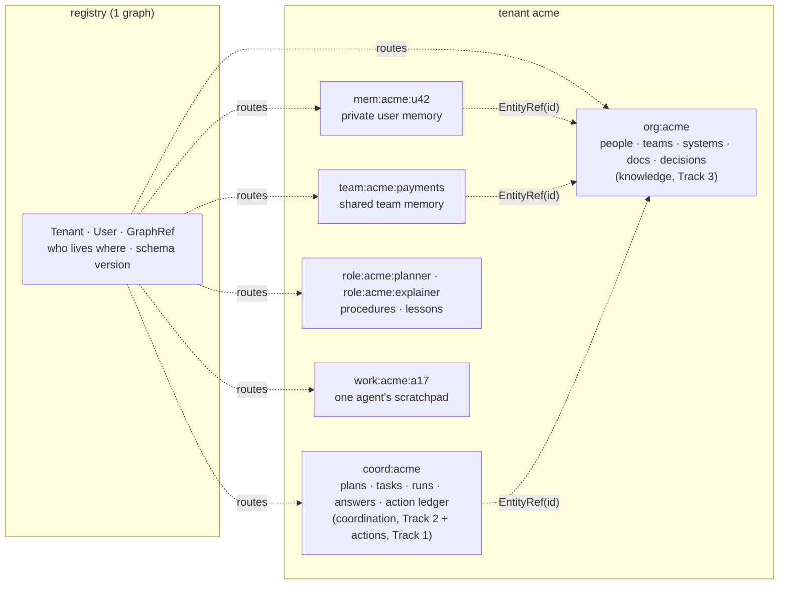
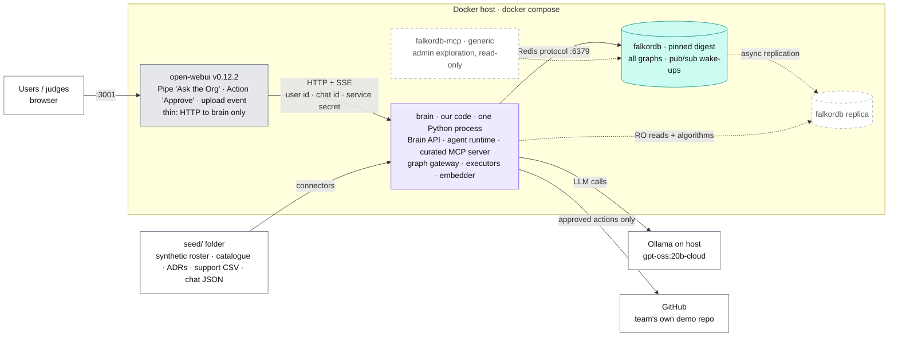
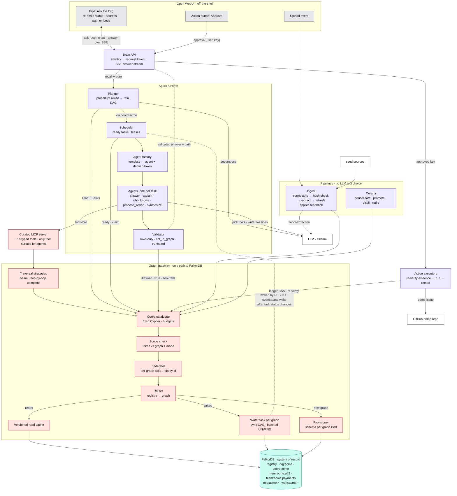
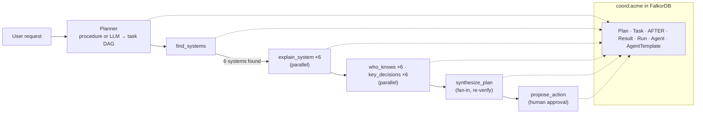
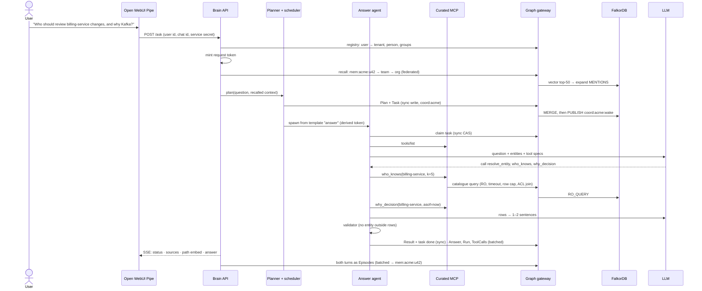
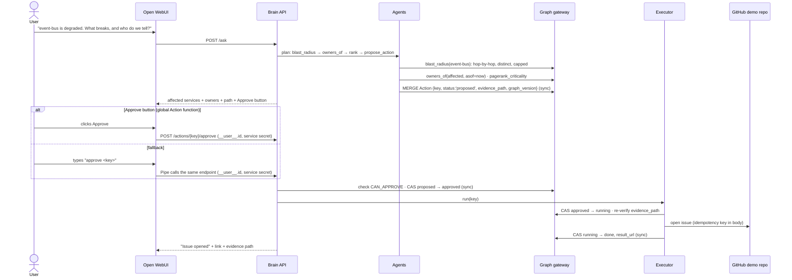

# Ask the Org: Architecture v2.1 (built to scale)

> **Tracks entered:** Company Brain (primary) · Agent Memory and Coordination · Agents That Act on Connected Data.
> **Pitch:** An "Ask the Org" agent platform that answers how a company works, remembers every user, coordinates several agents, and acts. Everything it knows and does lives in FalkorDB, and every answer shows its path and sources.
> **v2 → v2.1:** v2 solved scale problems (supernodes, path explosion, a single writer per graph, RAM limits, duplicates, staleness, racing agents). v2.1 fixes the **gaps and contradictions** found in the 16 Oct review: a broken blast-radius query, two competing agent loops, no user identity on the MCP path, hash tags that blocked scale-out, broken graph ownership, a god-object gateway, and a scope too large for the deadline. The full list is in [§0.1](#01-what-changed-in-v21).
> **Wiring proven:** [OPENWEBUI_FEASIBILITY.md §0](OPENWEBUI_FEASIBILITY.md).
> **Naming:** `org:<t>` means "the org graph of tenant `<t>`", e.g. `org:acme`. Diagrams use concrete names. Graph names contain **no `{}`**, so no Redis hash tags (see U6).

---

## 0. FalkorDB facts the design is built on

"Docs" = read in the official docs on 16 Oct 2026. "Spike" = run on our local FalkorDB (module `graph` ver `42201`, image digest in [§10](#10-deployment)) on 16 Oct 2026.

| # | Fact | Source | Design consequence |
|---|---|---|---|
| F1 | **Writes are serialized per graph** (FIFO, atomic). Reads run in parallel on a thread pool (`THREAD_COUNT`). | Docs: [Concurrency](https://docs.falkordb.com/design/concurrency) | Partition data into many graphs. One writer task per graph. A conditional `SET` is a compare-and-set. |
| F2 | **Each graph is one key, so it lives on one shard.** Clusters shard by key across 16,384 hash slots. | Docs: [Cluster](https://docs.falkordb.com/operations/cluster.md) | No single graph may need to outgrow one machine. Cross-graph joins happen in our code. |
| F3 | **Single-primary replication.** Replicas are read-only and asynchronous. | Docs: [Replication](https://docs.falkordb.com/operations/replication) | Route `RO_QUERY` and heavy algorithms to replicas. Read your own writes from the primary. |
| F4 | **`MULTI/EXEC` blocks other graphs too.** | Docs: [Concurrency](https://docs.falkordb.com/design/concurrency) | Never use it. One write = one Cypher query (`UNWIND` batch). |
| F5 | Safety limits: `TIMEOUT`/`TIMEOUT_MAX`, `RESULTSET_SIZE`, `QUERY_MEM_CAPACITY`, `MAX_QUEUED_QUERIES`. Settable at runtime. The pinned image ships with **`TIMEOUT 1000` ms, `MAX_QUEUED_QUERIES 25`, `RESULTSET_SIZE 10000`**. | Docs: [Configuration](https://docs.falkordb.com/getting-started/configuration) · Spike: `MODULE LIST` | Every query has a budget. A 1 s default timeout means algorithms need an explicit per-query timeout. |
| F6 | **Unique constraints** need an exact-match index first. | Docs: [Constraints](https://docs.falkordb.com/commands/graph.constraint-create.md) | The provisioner creates index, then constraint, per graph kind ([§2.1](#21-provisioning-and-schema)). |
| F7 | **Vector index** is HNSW and approximate, memory ≈ vectors × dims × 4 B + 20%, and it **filters poorly**. | Docs: [Vector index](https://docs.falkordb.com/cypher/indexing/vector-index) | Per-tenant and per-user graphs give per-scope indexes, which avoids filtering. Keep dimensions small. |
| F8 | **JavaScript UDFs can traverse but are read-only.** | Docs: [UDFs](https://docs.falkordb.com/udfs/) | In-database beam traversal is a stretch goal. |
| F9 | Algorithms available: `algo.pageRank`, `algo.betweenness`, `algo.WCC`, `algo.labelPropagation`, `algo.SPpaths`, `algo.SSpaths`, **`algo.BFS`** (capital), `algo.HarmonicCentrality`, `algo.MSF`, `algo.maxFlow`, `algo.AStar`. **`algo.BFS` follows outgoing edges only.** **`algo.betweenness` over directed Person→System edges scores every node 0.** | Spike: `dbms.procedures()`, test graphs | Blast radius (incoming `DEPENDS_ON`) can't use `algo.BFS` directly ([§3.4](#34-the-organizers-four-canonical-questions)). Bus factor is a count query, not betweenness ([§3.1](#31-company-brain-primary-track)). |
| F10 | Temporal types exist (Date, DateTime, Duration). | Docs: [Data types](https://docs.falkordb.com/datatypes.md) | Bitemporal edges (`valid_from`/`valid_to`/`recorded_at`). We store epoch ms for range indexes. |
| F11 | Gotchas: `LIMIT` doesn't stop eager writes. `<>` can't use an index. No aggregation inside pattern comprehensions. | Docs: [Limitations](https://docs.falkordb.com/cypher/known-limitations) | Lint rules for `queries/`. |
| F12 | **Variable-length bounds can't be parameters.** `-[:R*1..$depth]->` fails with `Encountered unhandled type in inlined properties`. A literal `*1..3` works. | Spike | Depth is a literal in each catalogue query, or the traversal runs hop by hop in the gateway. |
| F13 | **Redis `PUBLISH` works on the FalkorDB instance.** | Spike (`PUBLISH coord:acme:wake t2` → OK) | Cheap wake-up hints for the scheduler. Pub/sub is lossy, so state stays in the graph and a slow poll is the fallback. |
| F14 | **Atomic claim works as designed.** Two claims on the same open task: the first returns the row, the second returns nothing. The ready-task query and `MERGE` on an expression key (`$parent + ':' + it.id`) also work. | Spike | The task runtime's core queries ([§4.4](#44-parallel-and-dynamic-agents-the-task-runtime)) are verified, not assumed. |
| F15 | **Open WebUI Action functions carry a trustworthy identity.** `POST /api/chat/actions/{id}` gives the function `__user__` from the verified session; a fake `user` field in the request body is ignored. The chat must belong to the caller (someone else's chat → 404). For non-admins the action must be attached to the model or **global**. A Pipe with **no saved workspace model entry is invisible to non-admin users** ("Model not found") until it gets a read grant `{principal_type:'user', principal_id:'*', permission:'read'}`. | Spike (`run_action_spike.py`, v0.12.2 source) | The Approve button is safe to build on. Setup must create the Pipe's model entry with a read grant and make the action global. |

### 0.1 What changed in v2.1

| # | Problem found in review | Fix | Where |
|---|---|---|---|
| 1 | Q4 blast-radius sketch fails (F12) and enumerates every path (contradicts U2) | Hop-by-hop distinct-node expansion in the gateway, verified on the spike | F12, U2, §3.4 |
| 2 | Two agent loops: Open WebUI's own MCP client skipped the planner, memory and validator | The **Pipe is the only product model**. Our runtime's agents are the MCP clients. The generic FalkorDB MCP server is admin-only, read-only. | §2.2, §3.3, §4 |
| 3 | No user identity on the MCP path (`auth_type: none`), so scope tokens and ACLs failed open | The Pipe forwards the Open WebUI user. The Brain API resolves it in the registry and mints the scope token. Agents only get **derived (narrower) tokens**. | §2.2 |
| 4 | Hash tags put a whole tenant on one shard, contradicting "graphs spread across the cluster" | No hash tags. The registry maps graph → shard-agnostic name. | U6, §2 |
| 5 | Curator and action agent wrote to `org:<t>`, which is "ingest only" | Feedback and agent-made artefacts go to `coord:<t>` and reach `org:<t>` **only through the ingest pipeline** | §3.1, §4 contracts |
| 6 | Batched writer queue vs. claims that need an immediate answer | **Two write modes** on one writer task per graph: `sync` (CAS, returns the row) and `batched` (write-behind `UNWIND`). Order is preserved. | U3, §4 contracts |
| 7 | Gateway held ML models, the validator and GitHub calls. The validator also appeared in two places. | Gateway = database access only. Validator lives in the runtime. Executors are their own module. | §4.2 |
| 8 | Scheduler had no way to learn that tasks became ready | `PUBLISH` wake-up after task status changes, plus a 2 s poll fallback (F13) | §4.4 |
| 9 | Recall ran twice (memory filter and orchestrator) | Memory filter removed. The Brain recalls once per request and writes both turns as episodes. | §3.2, §5 |
| 10 | Answer and Action agents had no caller. Planner, scheduler and factory never reached the graph in the diagram. | **Every request is a `Plan`**, even a one-task plan. All agents are spawned per task from templates. | §4.4 |
| 11 | No provisioning: new graphs had no indexes or constraints | Provisioner + `(:GraphRef {schema_version})` in the registry | §2.1 |
| 12 | Traces were not stored, so agent actions had no graph evidence (AGENTS.md §7) | `(:Run)-[:CALLED]->(:ToolCall)` and `(:Answer)` in `coord:<t>`, written in one batch per run | §6 |
| 13 | Approval and external actions weren't drawn | Approval sequence with an Open WebUI Action button, CAS state transitions and evidence re-verification | §3.3, §5.2 |
| 14 | Bus factor via betweenness always returns 0 on Person→System edges (F9) | Bus factor = distinct current experts per system. Betweenness runs on `DEPENDS_ON` (chokepoints). | §3.1 |
| 15 | Procedural memory lived in three places (`Procedure` in user memory, template stats, role graphs) | Procedures live in the planner's role graph `role:<t>:planner`. Lessons live in each worker role's graph. Templates in `coord:<t>` keep only counters. | §4.5 |
| 16 | Results pointed at working graphs that get deleted, or at `org` writes workers aren't allowed to make | A `Result` carries bounded rows of **ids, scores and evidence paths**, never text. Text is re-read from `org` by id. | §4.4 |
| 17 | `CLAIMED_BY` edge duplicated the `owner` property and was never written | Removed. One `(:Run)` per attempt records history. | §6 |
| 18 | Scope (~18 "✅ demoed" items) vs. a deadline of **18 Oct, 11:59 PM IST** | P0 / P1 / P2 priorities. Only P0 is promised in the demo. | §7 |
| 19 | Unpinned `:latest` images | Images pinned by digest | §10 |
| 20 | Diagram: dangling boxes, missing edges, built and designed parts drawn the same | Three views: deployment, components, track map. Dashed = designed or P2. | §4 |
| 21 | P0 had only episodic memory; Track 2 asks for episodic, semantic **and** procedural | Minimal fact consolidation and one procedure reuse promoted to P0, with a demo for each type | §3.2, §7 |
| 22 | P0 had docs and tickets but no chats; Track 3 asks for all three | Synthetic chat connector promoted to P0 (tier-2 links, no LLM) | §3.1, §7 |
| 23 | The Track 1 demo depended on an unverified Approve button | Spiked: works for a non-admin user with a server-side identity (F15). Typed `approve <key>` through the Pipe is the fallback. | §3.3, §5.2 |

---

## 1. Universal problems at scale (they hit every track)

| # | Problem | What breaks | Universal fix (all inside FalkorDB) |
|---|---|---|---|
| U1 | **Supernodes:** a person in 100k messages, an "Engineering" team, a shared `event-bus` | Variable-length traversals fan out exponentially | **Degree-aware traversal.** A refresh job writes `degree` and adds a `:Hub` label above a threshold. **Ranking** traversals don't expand *through* hubs unless the hub is the target. **Completeness** traversals do expand through hubs, but mark those links weak (inverse-degree weight). Nothing is silently dropped. **Summary edges** (`KNOWS_ABOUT`) replace walks over raw messages. |
| U2 | **Path explosion:** `-[*1..4]-` enumerates every path | Results hit the row cap, answers are slow | **Pick the traversal by question class ([§3.4](#34-the-organizers-four-canonical-questions)).** *Ranking*: beam traversal, top-k by weight per hop. *Completeness*: **hop-by-hop expansion over distinct nodes** run by the gateway (one indexed query per hop, a `seen` set, a depth cap and a node cap). Hitting a cap returns `truncated`. *Point-to-point*: `algo.SPpaths`. Explanations show top-k paths, but the **answer set is complete**. |
| U3 | **One writer per graph** (F1) | Many agents writing to one graph form a queue | **Partition by scope** (§2). The gateway runs **one writer task per graph** with **two modes**. `sync`: one conditional query, executed now, returns rows (claims, ledger transitions, status flips). `batched`: write-behind `UNWIND $rows … MERGE` every N ms (episodes, traces, ingest). A `sync` op first flushes that graph's pending batch, so order is preserved. Writes are idempotent, so retries are safe. |
| U4 | **Read load** | Thread pool saturates | **Read replicas** for `RO_QUERY` and algorithms (F3, P2). A **result cache keyed by `(graph, query_id, params, graph_version)`**. The writer task bumps `graph_version` after every commit, so invalidation is exact. Read-your-writes: a read in the same request first flushes and then goes to the primary. |
| U5 | **RAM:** FalkorDB is in-memory | Big text and vectors exhaust memory | **The graph holds structure, evidence pointers and short text.** Bodies live in files or object storage, referenced by `uri` + `content_hash`. **Small embeddings** (384 or 256 dims) on chunks that matter. Memory **consolidation + archival** keeps memory graphs bounded. |
| U6 | **One graph = one shard** (F2) | A giant single graph can't scale out | **Graph topology** (§2): many medium graphs (tenant, team, user, coordination). The cluster spreads them by key. **No hash tags**: co-locating a tenant's graphs buys nothing, because cross-graph joins happen in code anyway, and it would pin a large tenant to one shard. The **registry graph** says which graph holds what. |
| U7 | **Duplicate entities** ("Asha", "asha.rao@…", "@asha") | Split knowledge, wrong answers | **Entity resolution as data.** Deterministic ids + `UNIQUE` constraints (F6). `(:Alias)-[:REFERS_TO]->(:Person)`. Fuzzy candidates are recorded as `SAME_AS {score, method}` edges (P2). Merges are reversible. |
| U8 | **Staleness** | Old decisions, departed owners | **Bitemporal edges** (`valid_from`, `valid_to`, `recorded_at`). `SUPERSEDES` chains. Tombstones (`deleted_at`) instead of hard deletes. **Change detection by `content_hash`**. "As of" queries come for free. |
| U9 | **Derived data drifts** (scores, communities, `KNOWS_ABOUT`) | Rankings go stale or get recomputed too often | **Incremental refresh**: when ingest touches an entity, it queues that entity's neighbourhood for refresh. Global algorithms run on a projected subgraph (F9) and write back in batches with `score_at`. |
| U10 | **Runaway queries** | One query starves everyone | **Query budget per catalogue entry**: timeout, row limit, memory cap, depth (F5). `MAX_QUEUED_QUERIES` for backpressure. **Fixed query catalogue**, so no LLM-written Cypher in production (spike lesson 1). |
| U11 | **Vector search + filters** (F7) | Wrong-tenant hits, poor recall | Per-graph vector indexes. Two stages: vector top-50 → graph filter and expand → rank by graph score (neural rerank is P2). |
| U12 | **Explaining huge results** | Can't show 10k paths | Return the **top-k paths + an evidence count** ("3 strongest paths of 41"). |

---

## 2. Graph topology: how data is partitioned



**Writer role vs. writer task.** A *writer role* is who is **allowed** to write a graph (checked by scope tokens). The *writer task* is the gateway's single queue per graph that **physically** sends the writes (F1). Every graph has exactly one writer task. Some graphs allow several writer roles.

| Graph | Scope | Writer roles | Readers | Why separate |
|---|---|---|---|---|
| `registry` | global | provisioner | Brain API, gateway | Small, rarely written. Routing, identity mapping, schema version. |
| `org:<t>` | tenant | **ingest pipeline only** | everyone in the tenant, ACL-filtered | Read-heavy knowledge. Agent feedback and agent-made artefacts arrive as ingest records, never as direct writes. |
| `coord:<t>` | tenant | every agent (sync CAS ops, batched run traces), executors, Brain API (feedback, approvals) | every agent | Keeps hot coordination writes **off** the knowledge graph's writer queue (F1) |
| `team:<t>:<team>` | team | curator | members' agents | Shared memory without exposing private memory |
| `mem:<t>:<u>` | user | Brain API (episodes), curator (facts) | that user's requests only | Isolation by construction. Thousands of small graphs spread across the cluster. |
| `role:<t>:<template>` | agent role | curator | agents spawned from that template | Long-term memory per kind of agent. `role:<t>:planner` holds **procedures**. Worker roles hold **lessons**. |
| `work:<t>:<agent>` | one agent instance | that agent only | that agent, curator at retirement | Private working memory. Created on spawn, distilled and deleted on retirement (P1). |

**Cross-graph rule:** no Cypher query spans graphs. Graphs link through **global ids** (`EntityRef {id:'person:roster:asha'}`). The gateway's **federator** queries each graph and joins on ids in code.

### 2.1 Provisioning and schema

- Each graph kind has one schema file: `schema/<kind>.cypher` (exact-match indexes, then unique constraints (F6), range indexes on time fields, vector index where needed).
- The **provisioner** runs on first use of a graph name that isn't in the registry. It applies the schema, treats "already exists" errors as success, and records `(:GraphRef {name, kind, tenant, schema_version, created_at})`.
- A schema change bumps `schema_version`. The provisioner migrates graphs lazily on their next use.
- `work:<t>:<agent>` gets only an `id` index, so spawning stays cheap. A TTL sweeper deletes working graphs whose agent is gone.

### 2.2 Identity and scope tokens

1. Open WebUI calls the **Pipe** with `__user__` (id, email, role). The Pipe forwards the user id and chat id to the Brain API over HTTP with a **service secret** (a Pipe valve set from the environment at install time, never committed).
2. The Brain API resolves `(:User {owui_id})` in the registry → tenant, person id, groups. **Unknown user → refused**, not a default scope.
3. The Brain API mints a **request token**: `{tenant, user, person, groups, graphs: {org:acme: r, mem:acme:u42: rw, coord:acme: claim+publish, …}, expires}`, HMAC-signed with a server secret.
4. The agent factory gives each spawned agent a **derived token**. A derived token can only **narrow** the request token (fewer graphs, fewer modes), never widen it.
5. The gateway checks every call against its token. Denied calls are recorded in the trace.

The generic FalkorDB MCP server (`falkordb/mcpserver`) is **not attached to any user-facing model**. It is an admin exploration tool, run read-only (spike lesson 2).

---

## 3. Track-by-track deep dive

### 3.1 Company Brain (primary track)

| Scale problem | Solution | Key Cypher / mechanism |
|---|---|---|
| Ingesting many docs, tickets, messages | **Streaming ingest pipeline.** Source → normalizer → `content_hash` check → extractor → **batched `UNWIND` MERGE** via the `org:<t>` writer task | `UNWIND $rows AS r MERGE (d:Doc {id:r.id}) SET d += r.props` |
| Duplicate people and systems | U7: aliases + exact ids (P0), fuzzy `SAME_AS` (P2) | `MERGE (a:Alias {id:$alias}) MERGE (p:Person {id:$pid}) MERGE (a)-[:REFERS_TO]->(p)` |
| "Who knows X" over huge message volumes | **Summary edge** `(:Person)-[:KNOWS_ABOUT {score, evidence_score, feedback, evidence, last_at, source_ids}]->(:System)`, refreshed incrementally (U9). `score = evidence_score × (1 + feedback)`, with `feedback` clamped to **[−0.2, +0.2]**, so feedback can reorder close candidates but never outweigh evidence. | `MATCH (p:Person)-[k:KNOWS_ABOUT]->(:System {id:$s}) RETURN p, k ORDER BY k.score DESC LIMIT 5` |
| Answer feedback | Thumbs up/down on an answer are written as `(:Feedback {answer_id, verdict, by, at})` in `coord:<t>`. The **ingest pipeline** reads unapplied feedback, adjusts `feedback` on the `KNOWS_ABOUT` edges in that answer's evidence, and marks it applied. This keeps `org:<t>` single-role. | Feedback → ingest → `SET k.feedback = …` |
| Agent-made artefacts (an onboarding plan, an opened issue) | They enter `org:<t>` as an ingest `SourceRecord` with `source:'agent'` and the lowest trust tier, linked to the `Answer` that produced them. Agents never write `org` directly. | Connector `agent` |
| Supernode teams and channels | U1: `:Hub` label. Ranking traversals don't route through `#general` or "Engineering". | `WHERE NOT m:Hub OR m.id IN $targets` |
| Knowledge changes constantly | U8 bitemporal + `SUPERSEDES`. "Why did we pick Kafka **as of** March?" | `WHERE r.valid_from <= $asof AND (r.valid_to IS NULL OR r.valid_to > $asof)` |
| **Keeping knowledge current** | Connectors re-run on a schedule from their cursor. A changed item is re-extracted. Edges no longer supported get `valid_to = now` (not deleted). Touched entities are queued for refresh. Ingest posts an `(:Event {type:'IngestDone'})` to `coord:<t>`, which the scheduler can turn into a `flag_stale_decisions` task. | `(:SourceSystem {cursor})`, `Event` |
| **Document permissions** | Mirror source ACLs as edges `(:Group)-[:CAN_READ]->(:Doc)`. **Every doc-returning catalogue query joins through the asker's groups** (from the scope token). No visible source → no answer. | `MATCH (g:Group)-[:CAN_READ]->(d:Doc) WHERE g.id IN $groups` (to be profiled) |
| **Bus factor** (who is the only expert) | For each system, count **distinct current team members** with `KNOWS_ABOUT.score ≥ θ`. A count of 1 is a risk. (Betweenness on directed Person→System edges always returns 0, F9.) | `MATCH (p:Person)-[k:KNOWS_ABOUT]->(s:System) WHERE k.score >= $theta RETURN s.id, count(DISTINCT p) AS experts ORDER BY experts` |
| Chokepoint systems | `algo.betweenness` on `System–DEPENDS_ON`, and `algo.pageRank` on `DEPENDS_ON` for criticality. Stored as properties with `score_at`. | `CALL algo.pageRank('System','DEPENDS_ON')` (spike-verified) |
| Real teams vs. org chart | `algo.labelPropagation` on a Person–Person collaboration projection (P1) | stored `community` |
| Giant tenant | Split `org:<t>` by domain (`org:<t>:eng`, `org:<t>:sales`) via the registry (P2) | Federator fan-out |
| Many heterogeneous sources | **Connector contract:** every source emits `SourceRecord {source, native_id, kind, author, at, title, body_uri, links[], acl[]}`. One mapping file per source. | `connectors/<source>.py` + `mappings/<source>.yaml` |
| Incremental sync | **Sync state lives in the graph:** `(:SourceSystem {id, cursor, last_sync_at})` | `MATCH (s:SourceSystem {id:$src}) SET s.cursor = $cursor` |
| Accuracy of extracted links | **Extraction tiers:** (1) structured fields (author, assignee, CODEOWNERS, manifest deps, HR roster); (2) explicit references (URLs, `#123`, `@mention`, ADR front-matter); (3) LLM extraction. Every edge carries `tier`, `confidence`, `source_ids`. Answers prefer tiers 1–2. Low-confidence tier-3 edges go to `(:ReviewItem)`. | Edge properties |
| Projects connecting everything | `(:Project)` is first-class | `(:Team)-[:WORKS_ON]->(:Project)<-[:PART_OF]-(:Decision|:Ticket|:Doc)` |

**Hackathon connectors (public, synthetic or team-made data only):**

- **P0:** synthetic HR roster CSV, service catalogue YAML (`DEPENDS_ON` with `kind: sync|async`), ADR and docs Markdown folder, synthetic support-tickets CSV, and a **synthetic Slack-style chat export** (JSON). Together they cover all three official sources: docs, tickets and chats.
- **P1:** GitHub issues/PRs/CODEOWNERS from the team's own public repo.

**What the chat connector produces (P0, no LLM needed):** `(:Message {id, channel, at, uri, content_hash})`, `(:Person)-[:AUTHORED]->(:Message)`, and tier-2 `MENTIONS` edges from explicit references: `@handle` → `Alias` → `Person`, `#adr-7` or ADR URLs → `Doc`, and exact system names or aliases → `System`. A thread the generator marks as the discussion of a decision gets `(:Decision)-[:DECIDED_IN]->(:Message)`, so "why Kafka?" can cite both the ADR and the chat thread. Messages count as evidence for `KNOWS_ABOUT`, at a lower weight than authored docs.

### 3.2 Agent Memory and Coordination

| Scale problem | Solution | Key Cypher / mechanism |
|---|---|---|
| Persistent conversation history | The **Brain API writes both turns** of every Pipe request as `Episode`s (batched) into `mem:<t>:<u>`, linked to a `Session` keyed by the Open WebUI chat id. FalkorDB is the source of truth for recall. Open WebUI's own chat log is only for display, and its memory feature is off. | `(:Session {id:$chat})-[:CONTAINS]->(:Episode)` |
| Memory grows forever | **Three tiers + lifecycle:** episodes → **consolidation** into facts (curator `consolidate` task) → **archive** cold episodes to a file, keeping an `ArchiveSummary` node | `(:Episode)-[:CONSOLIDATED_INTO]->(:Fact)` |
| Picking the right memories | **Recall once per request**, before planning: vector top-50 in the user graph, expand via `MENTIONS` to current entities, rank by similarity × recency decay × importance × graph proximity. Then team graph, then org. | Federated recall (U11) |
| Contradicting memories | An LLM judge flags a contradiction between a new fact and an existing one (P1; an NLI model is P2) → `(:Fact)-[:SUPERSEDED_BY {at, reason}]->(:Fact)` and `valid_to` set. History is kept. | Bitemporal (U8) |
| Many concurrent writers | Per-user graphs give natural write parallelism (F1 across thousands of graphs). Episodes use **batched** writes. | `UNWIND $episodes …` |
| Agents racing for the same task | **Atomic claim with lease** as a **sync** write (F1, F14). Expired leases are re-claimable. | [§4.4](#44-parallel-and-dynamic-agents-the-task-runtime) |
| Handoffs losing context | A handoff is a `Task` with links to the facts and entities the next agent needs, not free text | `(:Task)-[:NEEDS_CONTEXT]->(:EntityRef)` |
| Duplicate work after retries | **Idempotency keys** on tasks and actions (`MERGE` on `key`, unique-constrained) | `Task.key`, `Action.key` |
| Shared vs. private memory | **Scope resolution order:** user graph → team graph → org graph. Promotion of a user fact to the team needs a rule or an approval, recorded as an edge. | `(:Fact)-[:PROMOTED_TO {by, at}]->(:EntityRef)` |
| Procedural memory that actually learns | When a plan succeeds (user accepts, actions approved), the curator distills its DAG into a `(:Procedure)` in **`role:<t>:planner`**: task types, order, templates, tools. The planner's **first step** is to retrieve a matching procedure and reuse it. Outcomes update `success`/`fail`. | `(:Procedure)-[:SOLVES]->(:TaskType)` |
| User facts vs. org knowledge | User facts ("prefers Python", "is onboarding to Payments") live in `mem:*`. They reach team memory only by promotion, and org knowledge only through ingest. | — |
| Proving concurrency | `bench/`: N simulated agents × M ops across shared `coord` + private `mem` graphs. Report p50/p95, queue rejections and lost writes (target 0). **Numbers are only claimed after running.** | Load script |

**Memory demo (all three types in P0):**

1. **Episodic.** Session 1: the user says they're onboarding to Payments and prefer Python. Both turns are stored as `Episode`s.
2. **Semantic.** When session 1 goes idle, the curator consolidates it into facts: `is onboarding to Payments`, `prefers Python`, each linked to its source episodes.
3. Session 2 (a new chat): "what should I read first?" is answered using those facts. The trace shows the `mem:acme:u42` hits and the `Fact → Episode` path back to session 1.
4. **Procedural.** The first "prepare onboarding for Payments" plan is decomposed by the LLM and, once accepted, distilled into a `Procedure`. A later "prepare onboarding for Search" reuses it: no decomposition call, same DAG shape, and the trace names the procedure.

### 3.3 Agents That Act on Connected Data

| Scale problem | Solution | Key Cypher / mechanism |
|---|---|---|
| Multi-hop on dense graphs | Ranking: beam traversal (U2), hop by hop with `LIMIT $k`, skipping hubs. Completeness: hop-by-hop distinct-node expansion with caps and a `truncated` flag. | Gateway traversal strategies |
| Algorithms as agent tools | `pagerank_criticality`, `chokepoints` (betweenness on `DEPENDS_ON`) and `path_between` (`algo.SPpaths`) are MCP tools. Scores are precomputed with `score_at`. A recompute tool exists but has its own budget and an explicit timeout (F5: default 1 s). | `CALL algo.SPpaths({sourceNode:a, targetNode:b, relTypes:['DEPENDS_ON'], weightProp:'weight', pathCount:3})` (spike-verified) |
| **Tool selection through MCP** | Every LLM-driven agent in our runtime is an **MCP client** of our curated MCP server (Streamable HTTP, bearer = its derived scope token). The LLM sees `tools/list` and picks. The trace stores each pick and its arguments. Deterministic pipelines (ingest, scheduler, curator jobs) call the gateway library directly with their own token. The trace records `via: mcp | pipeline`. | FastMCP server |
| Tool catalogue | ~10 typed tools: `resolve_entity`, `who_knows`, `owners_of`, `why_decision`, `blast_radius`, `path_between`, `pagerank_criticality`, `customer_requests`, `recall`, `propose_action`. Each declares its budget and target graph. | `mcp/tools.py` |
| Unsafe or duplicate actions | **Action ledger** in `coord:<t>`: `(:Action {key, type, status, evidence_path})`. Status changes are **sync CAS** writes: `proposed → approved → running → done | failed`, or `proposed → rejected`. Idempotent by `key`. | `MATCH (a:Action {key:$key}) WHERE a.status = 'proposed' SET a.status = 'approved', a.approved_by = $u, a.approved_at = $now RETURN a` |
| Human approval | The answer shows the proposal and its key (``action-key: `act:acme:open_issue:…` ``). A **global Approve Action function** (spike-verified, F15) reads the key from the message and calls `POST /actions/{key}/approve` with `__user__.id` from Open WebUI's verified session plus the service secret. **Fallback:** the user types `approve <key>` in the chat; the Pipe recognises it and calls the same endpoint with its own `__user__`. Either way the Brain API checks `(:User)-[:IN]->(:Group)-[:CAN_APPROVE]->(:ActionType)` and the action's tenant, then runs the CAS. Nothing that leaves the system runs without this step. | [§5.2](#52-track-1-flow-act-on-what-the-graph-shows) |
| Acting on stale data | Every action records `graph_version` + `evidence_path`. The executor **re-runs the path query** before executing. A missing path → `failed: evidence_changed`. | Re-verify query |
| Real actions | Executors (outside the gateway): `open_issue` (only on the team's own demo GitHub repo; the idempotency key goes in the issue body so a retry finds the existing issue), `create_onboarding_plan` (stored in `coord:<t>`, shown in chat, ingested as an agent artefact), `notify` (shown in Open WebUI) | `executors/` |
| Explanations that can't be faked | The answer object is built only from tool rows: entities, top-k paths, sources, trace. The **validator in the runtime** rejects any entity not in the rows. An empty traversal yields `not_in_graph`. A capped one yields `truncated`. | Validator + outcome codes |

**Track 1 demo flow, "incident triage":** "event-bus is degraded. What breaks, and who do we tell?" → `blast_radius(event-bus)` → `owners_of(affected, asof=now)` → `pagerank_criticality` to rank them → `propose_action(open_issue)` with the evidence path → **Approve** → the issue is opened on the demo repo with the affected services, owners and path → the ledger shows `done` with the issue URL. The graph decides *what* the action contains and *whom* it targets.

---

### 3.4 The organizers' four canonical questions

Correctness depends on three things: **the data is modelled**, **the right query class is used**, and **the answer is built from rows, not from the LLM**.

| Class | Correct strategy | Wrong strategy (bug avoided) |
|---|---|---|
| **Completeness:** "everything linked or affected" | Hop-by-hop expansion over **distinct nodes**, depth cap + node cap, explicit truncation flag. Hubs traversed but marked weak. | Top-k beam or hub skipping, which silently drops true answers. Path enumeration with `*1..n`, which explodes (U2). |
| **Ranking:** "who is best or most" | Summary edges + beam top-k with scores | Exhaustive enumeration |
| **Temporal lookup:** "what happened in window X, and its status" | Range-indexed time properties (epoch ms) + explicit status and resolution edges | Asking the LLM whether something "seems resolved" |

| # | Question | Covered? | What makes it correct | Model / query |
|---|---|---|---|---|
| Q1 | Which accounts are linked to this flagged transaction? | ⚠️ **Not by the company pack.** Needs a risk domain pack (P2). | Completeness class. Shared devices and IPs are the signal, so don't skip them. Weight each link by inverse degree. `algo.WCC` on the bounded neighbourhood gives the ring. | `(:Account)-[:SENT]->(:Transaction)`, `-[:USES_DEVICE]->(:Device)`, `-[:LOGGED_FROM]->(:IP)` |
| Q2 | What did this customer ask for last month, and was it resolved? | ✅ with the support CSV (P0) | Temporal class. "Resolved" comes from **status + a `RESOLVED_BY` edge**, never inferred. | `(:Customer)-[:RAISED]->(:Request {status, opened_at, resolved_at})-[:RESOLVED_BY]->(:Ticket|:Doc)` |
| Q3 | Who on the team has worked on this system before? | ✅ **Core** | Ranking class. "On the team" = asker's **current** `MEMBER_OF`. "Worked on" comes from structured evidence first. Every person returned carries their evidence. | `KNOWS_ABOUT` + drill-down |
| Q4 | What breaks if this service goes down? | ✅ **Core** | Completeness class. Follow **incoming** `DEPENDS_ON`. Distinct services + minimum hop count. **No hub skipping.** `kind: sync|async` gives severity. Unmodelled dependencies are reported as unknown, not as "nothing breaks". | `(:System)-[:DEPENDS_ON {kind, weight}]->(:System)` |

**Catalogue queries:**

```cypher
// Q4 blast radius: completeness class. Spike-verified (16 Oct).
// The gateway runs this once per hop: frontier = ids found at the previous hop,
// seen = every id found so far. It stops when the frontier is empty, hop = $max_depth,
// or |seen| reaches the node cap (then the outcome is `truncated`).
// The hop number at which an id first appears is its minimum distance.
MATCH (n:System)<-[:DEPENDS_ON]-(up:System)
WHERE n.id IN $frontier AND NOT up.id IN $seen
RETURN DISTINCT up.id AS service
LIMIT $node_cap
// Why not `-[:DEPENDS_ON*1..$depth]->`: bounds can't be parameters (F12), and it enumerates paths (U2).
// Why not algo.BFS: it only follows outgoing edges (F9).

// Q3 who on my team worked on it: ranking class
MATCH (me:Person {id:$asker})-[m1:MEMBER_OF]->(t:Team)<-[m2:MEMBER_OF]-(p:Person)
WHERE m1.valid_to IS NULL AND m2.valid_to IS NULL
MATCH (p)-[k:KNOWS_ABOUT]->(:System {id:$sys})
RETURN p.id, p.name, k.score, k.evidence, k.last_at ORDER BY k.score DESC LIMIT $k

// Q2 customer requests last month: temporal class
MATCH (c:Customer {id:$cid})-[:RAISED]->(r:Request)
WHERE r.opened_at >= $from_ms AND r.opened_at < $to_ms
OPTIONAL MATCH (r)-[:RESOLVED_BY]->(x)
RETURN r.id, r.summary, r.status, r.resolved_at, x.id ORDER BY r.opened_at
```

Q2 and Q3 are still sketches and must be checked with `GRAPH.PROFILE` on the large synthetic graph.

**How we prove accuracy:** the synthetic org generator plants a **known ground truth** (true dependency closure, true contributors, true request statuses). `tests/golden/` asks each canonical question and scores **precision and recall** of the returned set, plus the outcome code (`answered_with_path` / `not_in_graph` / `truncated`). We only publish scores we ran.

---

## 4. Integration: one platform, three tracks

The tracks are not three apps. They are **agent roles on one graph platform**. Every request becomes a plan in `coord:<t>`. Every LLM-driven agent reaches tools through **one curated MCP server**. Everything reaches FalkorDB through **one graph gateway**.

**Diagram legend:** grey = off-the-shelf, purple = our agents and pipelines, coral = our tool and graph layer, teal = FalkorDB, white = external. **Solid = P0/P1 build. Dashed = designed only (P2).**

### 4.1 Deployment view (what runs where)



### 4.2 Component view (how a request moves)

Top to bottom: shell → Brain API → agents and pipelines → MCP → gateway → FalkorDB. The two dotted links without arrowheads are return paths: the validated answer streaming back to the Brain API, and the writer task waking the scheduler with `PUBLISH`.



`TRAV` runs one or more catalogue queries per tool call (a blast radius is one query per hop). Simple tools pass straight through it to the catalogue.

### 4.3 Track map (where each track is visible)

| Track | Focus (official) | Components | Graphs | Demo moment |
|---|---|---|---|---|
| **Company Brain** | docs/tickets/chats in one graph; who owns and knows what; decisions traced to sources; kept current; clear sources | Ingest (docs, support tickets, chat), catalogue (`who_knows`, `owners_of`, `why_decision`), validator | `org:acme` | Ask "why Kafka?" → decision → ADR **and** the chat thread where it was argued → authors, with sources. Edit the ADR file, re-run ingest, ask again **as of** before and after. |
| **Agent Memory and Coordination** | episodic, semantic, procedural memory; history; handoffs; concurrency; per-user/tenant memory | Brain API episodes, curator (consolidation), planner (procedures), scheduler, factory, writer tasks | `mem:*`, `team:*`, `role:*`, `work:*`, `coord:acme` | Session 2 uses facts consolidated from session 1 (episodic → semantic). The second onboarding plan reuses the first one's procedure (procedural). The plan fans out into ~14 parallel tasks, live in FalkorDB Browser. `bench/` numbers. A second user can't see the first user's memory. |
| **Agents That Act** | multi-hop; algorithms as tools; tool selection through MCP; actions; explainable | MCP server, traversal strategies, `algo.*` tools, action ledger, executors | `org:acme`, `coord:acme` | Incident triage: blast radius → owners → **Approve** → GitHub issue opened, ledger `done`, trace shows each MCP pick. |

### How the tracks feed each other (the flywheel)

1. **Ingest (T3)** writes knowledge into `org:<t>` and posts `IngestDone` to `coord:<t>`.
2. A user request becomes a **Plan**. **Answer agents (T3 + T1)** read `org:<t>` plus the user's recalled memory (T2) and return paths + sources.
3. **propose_action (T1)** turns an answer into a ledgered, idempotent action with its evidence path. A human approves. An executor runs it.
4. The **Brain API** writes both turns as episodes. The **curator (T2)** consolidates episodes into facts and distills successful plans into procedures.
5. **Feedback** on answers is recorded in `coord:<t>` and applied by **ingest** to `KNOWS_ABOUT` (bounded), so the knowledge graph keeps one writer role.
6. Every handoff between steps is a `Task` in `coord:<t>`, claimed atomically with a lease.

**Integration contracts:**

| Contract | Rule |
|---|---|
| Global ids | `<type>:<source>:<native-id>`, used everywhere, unique-constrained per graph |
| Ownership | Writer roles per graph as in §2. Exactly one writer **task** per graph. `org` is written only by ingest. |
| Write modes | `sync` for anything whose result decides the next step (claims, ledger, status). `batched` for everything else. A `sync` op flushes the graph's pending batch first. |
| Read-your-writes | A read after a write in the same request flushes that graph and goes to the primary. Other reads may use replicas (P2). |
| Identity | Only the Brain API mints request tokens. Agents get derived tokens that can only narrow. Unknown user → refused. |
| Tool surface | LLM-driven tool choice happens only through the curated MCP server. Pipelines call the gateway directly. Both are traced with `via`. |
| Events | Agents communicate only through `coord:<t>` nodes (Plan, Task, Result, Event). Pub/sub carries wake-ups only, never state. |
| Provenance | Every derived edge stores `source_ids`, `method`, `at`. Every answer stores `evidence_path`, and every run stores its tool calls. |
| Budgets | Every catalogue query declares a timeout, row limit, depth and target graph kind |
| Gateway scope | The gateway does database access only. No models, no validation of LLM text, no external calls. |

### 4.4 Parallel and dynamic agents (the task runtime)

**Every request is a plan.** A simple question is a one-task plan (`answer`). "Prepare onboarding for a new Payments engineer" is a multi-task plan. This gives every agent a caller (the scheduler), a record (the `Plan` in `coord:<t>`) and one execution model.

| Component | Job |
|---|---|
| **Planner** | First retrieves a matching `Procedure` from `role:<t>:planner`. If none fits, asks the LLM for a decomposition into known task types. Writes `(:Plan)-[:HAS]->(:Task)` and `(:Task)-[:AFTER]->(:Task)` as one sync write. |
| **Scheduler** | Wakes on `coord:<t>:wake` (or every 2 s), runs the ready-task query, dispatches up to the concurrency limit |
| **Agent factory** | Spawns an agent from `(:AgentTemplate {role, tools, prompt, budget, success, fail})` with a derived scope token, and records `(:Agent)` |
| **Agents** | Asyncio tasks. Each claims its task (sync CAS lease), calls only its allowed MCP tools, writes a `(:Result)-[:FOR]->(:Task)` (sync) and its `Run` + `ToolCall`s (batched) |
| **Synthesizer** | A fan-in task that runs when its inputs are done. Re-verifies each result's evidence path, merges, and hands the answer to the validator. |

**Results carry ids, not text.** A `Result` holds at most 50 rows of `{id, score, evidence_path}` plus a one-line summary. The synthesizer re-reads text from `org:<t>` by id. Nothing depends on a working graph that will be deleted.

**Dynamic fan-out (the graph decides the agent count):**
"Onboarding for Payments" → `find_systems(team)`. When it finishes (say 6 systems), the planner **spawns 6 parallel `explain_system` tasks**. Each spawns `who_knows` + `key_decisions` (12 more). Then one `synthesize_plan`, then one `propose_action` (human approval).

**Queries that drive it (F1, F14: spike-verified):**

```cypher
// ready tasks: open, and every AFTER-dependency is done
MATCH (:Plan {id:$plan})-[:HAS]->(t:Task {status:'open'})
OPTIONAL MATCH (t)-[:AFTER]->(d:Task)
WITH t, sum(CASE WHEN d IS NULL OR d.status = 'done' THEN 0 ELSE 1 END) AS pending
WHERE pending = 0
RETURN t.id, t.capability LIMIT $slots

// claim with lease (sync write). A second claimer gets no row.
MATCH (t:Task {id:$id})
WHERE t.status = 'open' OR (t.status = 'claimed' AND t.lease_until < $now)
SET t.status = 'claimed', t.owner = $agent, t.lease_until = $now + $ttl, t.attempts = coalesce(t.attempts, 0) + 1
RETURN t.id

// dynamic fan-out: one child task per item found by the parent (idempotent by key)
UNWIND $items AS it
MERGE (c:Task {key: $parent + ':' + it.id})
ON CREATE SET c.id = $parent + ':' + it.id, c.status = 'open', c.capability = $cap, c.input = it.id, c.depth = $depth + 1
WITH c
MATCH (p:Plan {id:$plan}) MERGE (p)-[:HAS]->(c)
```

After any sync write that changes a task's status, the writer task sends `PUBLISH coord:<t>:wake <plan id>` (F13).

**Guardrails:**

| Risk | Guardrail |
|---|---|
| Infinite decomposition | `max_depth` per plan (e.g. 3). Deeper tasks are refused. |
| Agent explosion | `max_agents` per plan + a global concurrency semaphore. The rest wait as `open` tasks. |
| Cost blow-up | Per-plan token and query budget. The plan becomes `partial` when exhausted, with what was found. |
| Crashed agent | Lease expiry → re-claim. `max_attempts` → `failed` (dead letter), shown in the answer. |
| Lost wake-up | Pub/sub is lossy, so the scheduler also polls every 2 s |
| Duplicate work | Idempotent `MERGE` on `Task.key` and `Action.key` |
| Conflicting results | The synthesizer only uses results whose evidence path re-verifies. Conflicts are surfaced, not averaged. |
| Hot coordination graph | `coord:<t>` gets only small writes: status flips, bounded results, one trace batch per run |

**Why this is the Track 2 centrepiece:** shared state (the plan DAG), handoffs (`AFTER` edges + `Result` nodes), high-concurrency reads and writes (N agents claiming and completing) and procedural memory (procedures + template stats) are all **visible live in FalkorDB Browser** and as a DAG embed in Open WebUI. We don't use Open WebUI's built-in sub-agents, because their state isn't in the graph.



---

### 4.5 Separate memory for every agent (including dynamically spawned ones)

**Problem:** with many parallel agents, a shared memory pool causes contamination (agents see each other's half-finished work), contention (every scratch write queues behind one writer, F1) and no accountability.

**Solution: a five-level memory hierarchy, every level a FalkorDB graph, with access enforced by scope tokens.**

| Level | Graph | Holds | Agent's access |
|---|---|---|---|
| 1. Working memory (per agent instance, P1) | `work:<t>:<agent>` | Scratch notes, intermediate rows, hypotheses | read/write, private |
| 2. Role memory (per agent type) | `role:<t>:<template>` | Worker roles: lessons and known pitfalls. Planner role: procedures. | read; the curator writes |
| 3. User memory | `mem:<t>:<u>` | The requesting user's episodes and facts | read only, **only for that user's tasks** |
| 4. Team and org knowledge | `team:<t>:<team>`, `org:<t>` | Shared knowledge | read only |
| 5. Shared coordination | `coord:<t>` | Plan, tasks, results, runs | claim tasks + publish results only |

Template-level counters (`success`, `fail`) stay on `(:AgentTemplate)` in `coord:<t>`, because the factory reads them when choosing a template. Everything richer lives in the role graph.

**Lifecycle of a dynamic agent's memory:**

1. **Spawn:** the factory provisions `work:<t>:<agent>` (id index only), seeds it with the task input and the top lessons from `role:<t>:<template>`, and registers `(:Agent)` in `coord:<t>`.
2. **Run:** the agent writes freely to its own working graph. It is the only writer role, so it never waits on another agent.
3. **Publish:** it shares only a bounded `(:Result)` in `coord:<t>`. No other agent reads its working memory.
4. **Retire:** the curator distills working memory into a lesson in the role graph (with success or fail), then deletes the working graph. A TTL sweeper catches missed retirements.

**Example derived token:** `{work:acme:a17: rw, role:acme:explainer: r, mem:acme:u42: r, org:acme: r, coord:acme: claim+publish}`. The gateway checks every call, and the trace shows denied calls.

**Why graphs and not in-process variables:** AGENTS.md §7 requires agent state as graph data. Per-agent graphs make each agent's reasoning **inspectable in FalkorDB Browser** and auditable afterwards through the distilled lesson.

---

## 5. Request flows

### 5.1 One question (Company Brain + Memory)



### 5.2 Track 1 flow: act on what the graph shows



---

## 6. Graph model (v2.1)

**`registry`**
```
(:Tenant {id, name})
(:User {id, owui_id, tenant, person_id})-[:BELONGS_TO]->(:Tenant)
(:GraphRef {name, kind, tenant, schema_version, created_at})-[:OF]->(:Tenant)
```

**`org:<t>`**
```
(:Person {id, name, degree})  (:Alias {id})-[:REFERS_TO]->(:Person)
(:User {id})-[:IS]->(:Person)   (:User)-[:IN]->(:Group)                          // mirrored identities + ACL groups
(:Person)-[:MEMBER_OF {valid_from, valid_to}]->(:Team)-[:OWNS {valid_from, valid_to}]->(:System {id, degree, pagerank, betweenness, score_at})
(:Person)-[:AUTHORED|COMMENTED {at}]->(:Doc|:Ticket|:Message {id, title, uri, content_hash, at, deleted_at})
(:Doc|:Ticket|:Message)-[:MENTIONS]->(:System|:Person|:Decision)
(:Decision {id, title, at, status})-[:DECIDED_IN]->(:Doc|:Ticket|:Message)
(:Decision)-[:MADE_BY]->(:Person)  (:Decision)-[:AFFECTS]->(:System)  (:Decision)-[:SUPERSEDES]->(:Decision)
(:System)-[:DEPENDS_ON {kind, weight, valid_from, valid_to}]->(:System)          // kind: sync | async
(:Person)-[:KNOWS_ABOUT {score, evidence_score, feedback, evidence, last_at, source_ids}]->(:System)   // derived
(:Group)-[:CAN_READ]->(:Doc)   (:Group)-[:CAN_APPROVE]->(:ActionType {id})
(:Chunk {id, text, embedding})-[:PART_OF]->(:Doc)                               // vector index (small dims)
(:Project {id, name, status})  (:Team)-[:WORKS_ON {valid_from, valid_to}]->(:Project)
(:Project)-[:USES]->(:System)  (:Decision|:Ticket|:Doc)-[:PART_OF]->(:Project)
(:Customer {id, name})-[:RAISED]->(:Request {id, summary, status, opened_at, resolved_at})-[:RESOLVED_BY]->(:Ticket|:Doc)
(:SourceSystem {id, cursor, last_sync_at})   (:ReviewItem {id, edge, confidence, status})
every extracted edge also carries {tier, confidence, source_ids}
extra label :Hub on high-degree nodes
```

**`mem:<t>:<u>` / `team:<t>:<team>`**
```
(:Session {id})-[:CONTAINS]->(:Episode {id, role, text, at, embedding, importance, access_count})
(:Episode)-[:NEXT]->(:Episode)   (:Episode)-[:MENTIONS]->(:EntityRef {id})
(:Episode)-[:CONSOLIDATED_INTO]->(:Fact {id, text, confidence, valid_from, valid_to})
(:Fact)-[:SUPERSEDED_BY {at, reason}]->(:Fact)   (:Fact)-[:PROMOTED_TO {by, at}]->(:EntityRef)
(:ArchiveSummary {period, episode_count, uri})
```

**`role:<t>:<template>`**
```
(:Lesson {id, text, success, fail, at})-[:ABOUT]->(:EntityRef {id})             // worker roles
(:Procedure {id, name, steps, success, fail})-[:SOLVES]->(:TaskType {id})        // role:<t>:planner
```

**`work:<t>:<agent>`**
```
(:Note {id, text, at})-[:ABOUT]->(:EntityRef {id})   (:Hypothesis {id, text, status})
```

**`coord:<t>`**
```
(:Plan {id, request, status, budget, max_depth, max_agents})-[:HAS]->(:Task {id, key, capability, input, depth, status, owner, lease_until, attempts})
(:Task)-[:AFTER]->(:Task)   (:Task)-[:NEEDS_CONTEXT]->(:EntityRef {id})
(:Result {id, summary, rows, evidence_path, at})-[:FOR]->(:Task)                 // rows: ≤ 50 {id, score, evidence_path}
(:AgentTemplate {id, role, tools, prompt, budget, success, fail})<-[:SPAWNED_FROM]-(:Agent {id, status, heartbeat})
(:Agent)-[:RAN]->(:Run {id, attempt, started_at, ended_at, outcome})-[:FOR]->(:Task)
(:Run)-[:CALLED]->(:ToolCall {seq, tool, query_id, graph, params_hash, rows, ms, outcome, via})
(:Answer {id, outcome, evidence_path, graph_version, at})-[:FROM_RUN]->(:Run)    // outcome: answered_with_path | not_in_graph | truncated
(:Feedback {id, verdict, by, at, applied})-[:ON]->(:Answer)
(:Action {key, type, status, evidence_path, graph_version, approved_by, approved_at, result_url})-[:BASED_ON]->(:Answer)
(:Action)-[:FOR_TASK]->(:Task)
(:Event {id, type, at, payload_ref})
```

**Identity:** every node is MERGE'd on `id` (or `key`) with an exact-match index + `UNIQUE` constraint (F6), created by the provisioner. Scope comes from the **graph name**, never a `WHERE` filter.

---

## 7. Scope honesty: what we build vs. what is designed

**Deadline: 18 Oct 2026, 11:59 PM IST.** P0 = in the demo and the README, must work. P1 = build if P0 is done and tested. P2 = designed only, described as such in the README.

| Capability | Priority | Hackathon build | Designed (P2) |
|---|---|---|---|
| Graphs: `registry`, `org`, `coord`, `mem` + provisioner | **P0** | 1–2 tenants | Hundreds of tenants on a cluster |
| `team` graph + fact promotion | P1 | One team | — |
| Brain API + Pipe + identity + request tokens | **P0** | HMAC tokens, service secret | Token rotation, audit export |
| Gateway: catalogue, budgets, scope check, router, sync + batched writer tasks, cache | **P0** | Single process, asyncio | Separate service, metrics |
| Curated MCP server, agents as MCP clients | **P0** | ~10 tools | — |
| Q2, Q3, Q4 + golden tests (precision/recall on planted truth) | **P0** | Company pack + support slice | Larger graphs, more question types |
| Connectors: roster, service catalogue, ADR/docs folder, support CSV, synthetic chat, with cursors | **P0** | Synthetic data; chat links via tier-2 references only | — |
| Connector: GitHub (own repo) | P1 | — | More sources via the same contract |
| Bitemporal + supersession | **P0** for decisions and ownership | — | Every edge type |
| Task runtime: plan, ready query, leases, fan-out, fan-in, wake-ups | **P0** | One end-to-end onboarding plan + live DAG embed | Learned decomposition |
| Action ledger + approval + `open_issue` executor + evidence re-verify | **P0** | One action type end to end | More executors |
| Episodes, recall, second-session demo (**episodic**) | **P0** | — | — |
| Consolidation into facts (**semantic**) | **P0** (minimal) | One curator `consolidate` task when a session goes idle: the LLM turns that session's episodes into ≤ 5 `Fact`s, each linked by `CONSOLIDATED_INTO` to the episodes it came from | Importance-weighted, scheduled consolidation; archival |
| Contradiction → `SUPERSEDED_BY` | P1 | LLM judge | NLI model |
| Procedures in `role:<t>:planner` + reuse (**procedural**) | **P0** (minimal) | When an onboarding plan succeeds, distill it into one `Procedure`. A second onboarding request (another team) matches it by `TaskType` and reuses its DAG without an LLM decomposition. The trace shows the procedure id. | Embedding-ranked procedures |
| `role:<t>:planner` graph | **P0** | Holds procedures only | — |
| `work:` graphs + lessons in worker role graphs | P1 | — | — |
| `KNOWS_ABOUT` summary edge | **P0** | Built from structured evidence | — |
| `KNOWS_ABOUT` feedback loop | P1 | Bounded ±0.2 | — |
| Algorithms as tools: `pagerank_criticality`, `path_between` | **P0** | Precomputed + `SPpaths` live | — |
| Bus factor, chokepoints (betweenness), communities | P1 | — | — |
| Extraction tiers 1–2 | **P0** | — | — |
| Extraction tier 3 + review queue | P1 | LLM with threshold | Human review UI |
| ACL mirroring (`CAN_READ`) | **P0** | Synthetic groups | Real SSO groups |
| Concurrency benchmark `bench/` | **P0** | Real numbers only | Larger synthetic org |
| Read replicas | P2 | — | Replica + Sentinel |
| Fuzzy `SAME_AS`, JS UDF traversal, domain split, neural reranker | P2 | — | ✓ |
| Q1 (linked accounts, risk pack) | P2 | — | Fraud domain pack |

Every P0 item must be **run and shown** before it is claimed in the README (AGENTS.md §9).

---

## 8. Neural components (outputs always land in the graph)

| Model | Job | Priority | Stored as |
|---|---|---|---|
| Small sentence embedder (384-d), in the brain process | Entity resolution entry points, memory recall | **P0** | `embedding` + per-graph vector index |
| LLM consolidation (the same Ollama model) | Session episodes → ≤ 5 facts | **P0** | `Fact` nodes + `CONSOLIDATED_INTO` edges |
| LLM structured extraction (the same Ollama model) | Tier-3 entities, decisions | P1 | Nodes/edges with `extractor`, `confidence`, `source_ids` |
| LLM judge | Contradictions between facts | P1 | `SUPERSEDED_BY` edges |
| GLiNER (NER), NLI model, cross-encoder reranker | Cheaper or better versions of the above | P2 | Same as above; reranker scores in the trace only |

One local model (the embedder) keeps RAM and setup small. Everything else reuses the LLM we already call.

---

## 9. Rule compliance

| Rule | How we comply |
|---|---|
| FalkorDB primary + central (removal test) | All knowledge, memory, coordination, actions, ACLs, traces and provenance live in FalkorDB. Without it, nothing answers, nothing is remembered and no task runs. Open WebUI memory and RAG are disabled. |
| Safe, bounded, parameterized Cypher | Query catalogue + budgets (U10). No string-built queries. Depth literals are fixed in the catalogue, never taken from input (F12). |
| Idempotent writes, deterministic ids | MERGE on unique-constrained `id` / `key` |
| Data: public / synthetic / own | Synthetic org + the team's own public repo. Origins in README. |
| Verified claims only | Facts marked "Spike" were run on 16 Oct. Benchmarks and features are claimed only after running. |
| No secrets in the repo | Service secret, token secret and GitHub token come from `.env` (gitignored) |
| AI-assistant disclosure | README section |

---

## 10. Deployment

- `docker compose` with four services: `falkordb`, `brain`, `open-webui`, and (admin only) `falkordb-mcp`. Ollama runs on the host.
- **Images pinned by digest** (the spike's verified versions):
  - `falkordb/falkordb@sha256:b0bdcac2cbaff989e77cb0610439b7a9289e86de033ccbbd4368b66fb680ae7a` (module `graph` ver `42201`)
  - `falkordb/mcpserver@sha256:a12b46009173c967d8ba04b5ae82bab1b4bb4a83a06ec45be6273fcf8984cdca`
  - `ghcr.io/open-webui/open-webui:v0.12.2`
- Ports: Open WebUI `3001`, FalkorDB `6379`, FalkorDB Browser `3010` (host 3000 is taken locally), brain `8000`.
- Open WebUI: `ENABLE_MEMORIES=False`, `OFFLINE_MODE=True`. Functions stay thin and call the brain over HTTP with `httpx` (spike lesson 4).
- Open WebUI setup script (from `spike/run_action_spike.py`): install the Pipe and the Approve action, make the action **active + global**, set the service-secret valve from `.env`, and create a **workspace model entry for the Pipe with a public read grant** (F15). Leave `BYPASS_MODEL_ACCESS_CONTROL` off, so users see only the Pipe and not the raw Ollama models.

---

## 11. Still to verify (not claimed yet)

| Item | How we'll check |
|---|---|
| ~~Open WebUI Action function can call the Brain API with the clicking user's id~~ | ✅ Verified 16 Oct through the endpoint the UI calls (F15). Still to do: see the button render under a Pipe answer in the browser. |
| Pipe receives the chat id (via `__metadata__`) for `Session` keys | Spike: log it |
| Python client `SUBSCRIBE` wake-ups under load | `bench/` with and without pub/sub |
| Q2/Q3 catalogue queries and the ACL join use indexes | `GRAPH.PROFILE` on the large synthetic graph |
| Graph creation + schema cost per spawned `work:` graph | Time 100 spawns in `bench/` |
| `ASYNC_DELETE` behaviour when retiring working graphs | Config check + timing |
